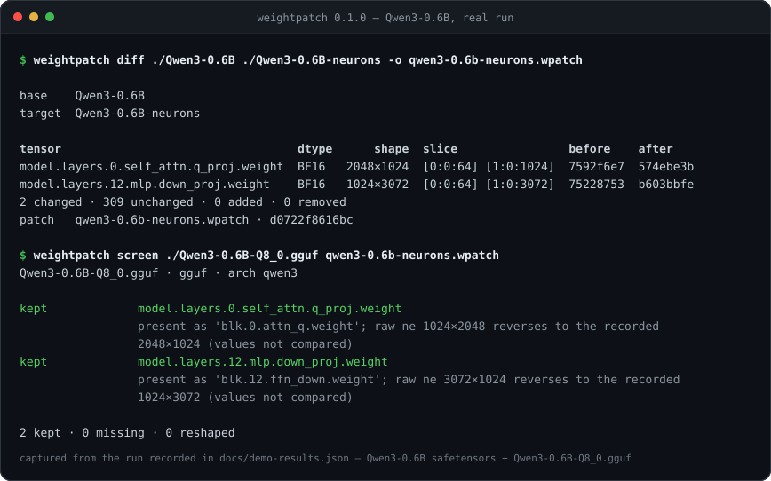

**English** | [简体中文](./README.md)

<div align="center">
  
</div>

<p align="center">
  
  
  
  
  
</p>

# weightpatch

**Turn a weight edit into a patch file you can review, revert, and verify.**

Weight surgery usually leaves two things behind: a new checkpoint of a dozen gigabytes, and one sentence in a README. The person receiving it cannot review what changed, cannot undo it, cannot stack a second edit on top, and cannot tell whether the edit survived requantization. weightpatch is that missing layer. Run `diff` over two local safetensors directories and the change becomes a sparse `.wpatch`; `apply` and `revert` replay and undo it by slice; `screen` takes the same patch to a single-file GGUF and reports how many edited tensors are still there.

Free, MIT-licensed, and entirely local. No server, no account, no network calls.

## Why this exists

A neuron edit or an expert prune only matters once it is handed to someone else. That handoff happens here:

- The publisher overwrites the checkpoint and uploads a new one. The edit exists only as "new weights minus old weights", a subtraction nobody performed.
- The downloader gets ten gigabytes of tensors and a prose sentence. Confirming which half of the experts went away means trusting the publisher.
- A downstream requantizer turns it into GGUF. This is where edits disappear most often: names move from `model.layers.12.mlp.down_proj.weight` to `blk.12.ffn_down.weight`, two-dimensional weights arrive transposed in GGML `ne` order, and quantization packs weights into blocks. The edited slices may still be there, or may have been flattened; you cannot tell by looking.
- When an agent or a script edits weights in place, the change is a mutation with no object to roll back.

This is not an English-only problem. Expert-pruned DeepSeek-V4.1-Flash builds, neuron-edited Qwen3.5-0.8B variants and abliterated Kimi K3 derivatives circulate as whole checkpoints through ModelScope and Gitee, then get quantized to different GGUF precisions by different people. weightpatch does not perform the edit. It owns the handoff of that edit.

## What it produces

A `.wpatch` is a zip with two members:

```
manifest.json
  id             sha256(base, parents, edit), content addressed
  base           { files: [{name, bytes, sha256}], tensor_count }
  parents        [id, ...], the stacking lineage
  edit.tensors   [{ name, dtype, element_size, shape,
                    ranges: [[dim, start, end], ...],   # bounding box of the changed slices
                    before_sha256, after_sha256, ref }]
  edit.added     added tensor names
  edit.removed   removed tensor names
  probe          { kind, claim, metrics }, the author's claim; never executed
values.npz
  raw machine words for the changed slices only: uint16 for BF16,
  uint8 bytes for every other dtype; no numpy floats, no decoding
```

Three decisions are worth spelling out:

- **Slices only.** If one region of a tensor changed, the patch carries that region. The patch stays readable, and it can be stacked.
- **Raw words, not floats.** numpy has no `bfloat16` dtype, and the `safetensors` numpy backend refuses to read BF16 at all. weightpatch parses the container itself (an 8-byte little-endian header length followed by a JSON offset table) and reads byte ranges, so a BF16 slice round-trips bit for bit.
- **Identity per tensor, not per checkpoint.** The id covers `(base, parents, edit)`; application verifies each touched tensor's `before_sha256`. A patch applies to any other base whose touched tensors still match.

## Install

Python 3.12 is required. From source:

```bash
git clone https://github.com/SuperMarioYL/weightpatch.git
cd weightpatch
uv venv --python 3.12
uv pip install --group dev -e .
source .venv/bin/activate

weightpatch --version
# weightpatch 0.1.0
```

`--group dev` also installs pytest. Drop it if you only want the command.

## Quickstart

This walks through the real Qwen3-0.6B. Any local BF16 checkpoint takes the same path; swap the directory names. First fetch the base: the single-file BF16 safetensors of `Qwen/Qwen3-0.6B`, about 1.5 GB.

```bash
mkdir -p Qwen3-0.6B
curl -fL -o Qwen3-0.6B/model.safetensors \
  https://huggingface.co/Qwen/Qwen3-0.6B/resolve/main/model.safetensors
```

Then make an "edited" copy with the example script in this repo: copy the directory, then rewrite the first 64 rows of two tensors in raw BF16 words, flipping one bit in every word. No randomness and no float decoding, so the same base bytes always produce the same post-edit digests:

```bash
python examples/make_demo_edit.py ./Qwen3-0.6B ./Qwen3-0.6B-neurons
# Qwen3-0.6B-neurons: 311 tensors
#   model.layers.0.self_attn.q_proj.weight  BF16 2048×1024  rows 0:64  sha256 574ebe3b4fcb427b
#   model.layers.12.mlp.down_proj.weight  BF16 1024×3072  rows 0:64  sha256 b603bbfe2b46e3b9
```

Then record, review, apply and revert:

```bash
weightpatch diff ./Qwen3-0.6B ./Qwen3-0.6B-neurons -o qwen3-0.6b-neurons.wpatch
weightpatch show qwen3-0.6b-neurons.wpatch

weightpatch apply  ./Qwen3-0.6B qwen3-0.6b-neurons.wpatch -o ./rebuilt
weightpatch revert ./rebuilt   qwen3-0.6b-neurons.wpatch -o ./back

cmp ./Qwen3-0.6B/model.safetensors ./back/model.safetensors && echo "revert is byte-identical"
```

The `diff` output is the list of changed tensors, not a dump of both models:

```
tensor                                  dtype      shape  slice                before    after
model.layers.0.self_attn.q_proj.weight  BF16   2048×1024  [0:0:64] [1:0:1024]  7592f6e7  574ebe3b
model.layers.12.mlp.down_proj.weight    BF16   1024×3072  [0:0:64] [1:0:3072]  75228753  b603bbfe
2 changed · 309 unchanged · 0 added · 0 removed
patch   qwen3-0.6b-neurons.wpatch · d0722f8616bc
```

`309 unchanged` is the rest of Qwen3-0.6B, untouched. After `apply` and then `revert`, `back/model.safetensors` is byte-identical to the base and `cmp` prints nothing. The patch id is `d0722f8616bcfc05a80870389ddbf6b279895c4f2eabe12f8fcd0124ea6741dd`; rerunning on the same inputs produces the same id.

`apply` and `revert` write only the tensor shards (plus `model.safetensors.index.json` when it exists). Non-weight files such as `config.json` and the tokenizer are not copied; the weights are the contract.

For a cross-base application, point the first argument at a different directory that still holds the same pre-image. To stack a second edit, `diff` the applied directory against its next state, then use `stack`.

## Demo



The recording above is a real terminal run: the base is `Qwen/Qwen3-0.6B` BF16 safetensors (311 tensors, 1,503,300,328 bytes), and the downstream artifact is the single-file `Qwen3-0.6B-Q8_0.gguf` (Q8_0, 639,446,688 bytes) from `Qwen/Qwen3-0.6B-GGUF`. No synthetic fixture, no locally forged GGUF.

1. `diff` finds two BF16 slice edits (`2 changed · 309 unchanged`) and writes patch `d0722f8616bc`.
2. `screen` reads `general.architecture=qwen3` and maps `model.layers.0.self_attn.q_proj.weight` to `blk.0.attn_q.weight` and `model.layers.12.mlp.down_proj.weight` to `blk.12.ffn_down.weight` through the GGML name table, then reverses the GGUF `ne` order: `1024×2048 → 2048×1024` and `3072×1024 → 1024×3072`.
3. The verdict is `2 kept · 0 missing · 0 reshaped`, exit code 0.

The commands, full output, input file sha256 values, dependency versions and the bounds of that run are recorded in [`docs/demo-results.json`](./docs/demo-results.json); rerunning the commands in this README reproduces the same output.

Run your own patch against your own single-file GGUF. This quantized export is a single file of about 639 MB from `Qwen/Qwen3-0.6B-GGUF`:

```bash
curl -fL -o Qwen3-0.6B-Q8_0.gguf \
  https://huggingface.co/Qwen/Qwen3-0.6B-GGUF/resolve/main/Qwen3-0.6B-Q8_0.gguf
weightpatch screen ./Qwen3-0.6B-Q8_0.gguf qwen3-0.6b-neurons.wpatch
```

The command exits non-zero as soon as an edit did not survive, so it can gate a release pipeline.

## Commands

| Command | What it does | Exit code |
| --- | --- | --- |
| `diff BASE TARGET [-o PATCH] [--json]` | Compare two safetensors directories tensor by tensor; report only changed slices | 0 on success |
| `show PATCH [--json]` | Print the recorded slices, dtypes, both digests and the probe | 0 on success |
| `apply TARGET PATCH -o OUT` | Write a copy of TARGET with the patch applied | 0 on success |
| `revert TARGET PATCH -o OUT` | Write a copy with the patch undone, byte-identical to the pre-edit state | 0 on success |
| `stack TARGET PATCH... -o OUT` | Apply two or more patches in order, verifying the pre-image chain per tensor | 0 on success; 2 with fewer than two patches |
| `screen SOURCE PATCH [--json]` | Check whether the edits survived a safetensors export or a single-file GGUF | 0 all kept; 1 any missing/reshaped; 1 nothing to screen |

Errors go to stderr with exit code 1; usage errors return 2. `diff`, `show` and `screen` accept `--json` and print a stable document for CI.

Three checks happen before anything is written:

- **A moved pre-image writes nothing.** `apply` hashes every touched tensor before copying any file; a mismatch exits without creating the output directory.
- **Stacked patches may not overlap slices.** Two patches that edit the same slices of the same tensor are refused, with the overlapping range in the error.
- **`stack` applies in the given order.** Every patch's pre-image must match the result of all writes before it; for a tensor touched by several patches that is a chained digest check, and any mismatch stops the run before anything is written.

## How `screen` decides

**GGUF** is checked for presence and shape only, never by dequantizing. The order is fixed, because skipping a step makes every edit look absent:

1. Read `general.architecture`. An architecture this `gguf` does not declare (say, a future `qwen4`) is reported `unsupported-arch` as a whole, with no name matching attempted.
2. Build the GGML name table from `arch` and `block_count`, then map each safetensors name. An unmapped name is `missing`; there is no string-similarity guess. If none of the declared tensors map (for example the `linear_attn.*` namespace of `qwen35`), the whole screen reports one `unmapped-arch` row: that is a hole in the name map, not per-tensor loss.
3. Reverse `GGUFReader.shape`. That field is GGML `ne` order, so every matrix arrives transposed; comparing it directly fails for every matrix.

A **quantized safetensors export** is compared on stored bytes. `kept` requires name, dtype, shape and byte digest to match the recorded post-edit tensor. A packed export (`U32` weights next to `.scales` / `.biases`) matches neither digest and has a different shape, so it is `reshaped`, with the companion tensor names listed beside it. That verdict says the weights were repacked; it makes no claim about the values.

The v0.1 boundaries:

- GGUF is read-only; no writing, no requantizing, no dequantizing to compare values.
- One `.gguf` file per screen; split sets (such as a ten-part DeepSeek-V4.1-Flash) cannot be opened.
- Architectures this `gguf` does not declare, and namespaces the name map cannot resolve, are reported as `unsupported-arch` / `unmapped-arch`; nothing is guessed.
- Slices only. A patch can record `added` / `removed` names but carries no values for them, so such a patch can be shown and screened, not applied.
- safetensors only; PyTorch `.bin` / pickle checkpoints are unsupported.
- No three-way merge, no interactive conflict resolution, no config file, no environment variables, no server.

## Compared with a whole checkpoint or a script

| | Whole checkpoint | Edit script | `.wpatch` |
| --- | --- | --- | --- |
| Handoff size | Dozens of GB | A few KB of code | Changed slices only |
| Receiver can review | No | Only by reading the code, in the same environment | `show` prints slices and both digests |
| Can be reverted | Only if the publisher kept the original | Only if the script still runs and the RNG matches | `revert` restores bytes exactly |
| Pre-image can be verified | No | No | Checked per tensor before `apply` |
| Can tell what survived requantization | No | No | `screen` |

Tools like heretic solve "make this edit". weightpatch solves "hand this edit over". They compose: edit a derivative directory however you like, then `diff` it into a patch.

## Roadmap

Everything described in this README works in v0.1.0: `diff`, `show`, `apply`, `revert`, `stack`, `screen` (safetensors and single-file GGUF), and the test suite above.

Not built, and not promised on a schedule:

- Reading split GGUF sets, so ten-part checkpoints like DeepSeek-V4.1-Flash can be screened.
- Comparing values per slice after dequantizing a GGUF, moving from "is it there" to "is it right".
- Carrying bytes for `added` / `removed` tensors so those patches can be applied.
- Three-way merge and interactive conflict resolution.

The next targets for validation on real derivatives are an expert-pruned DeepSeek-V4.1-Flash build, an edited Qwen3.5-0.8B, and an abliterated Kimi K3. The tests run on offline fixtures in a temporary directory and need no network; the demo and every number above come from the real Qwen3-0.6B and the real Q8_0 GGUF, recorded in `docs/demo-results.json`.

## License

MIT. See [LICENSE](./LICENSE).

<p align="center"><sub><a href="./LICENSE">MIT</a> © 2026 SuperMarioYL</sub></p>
