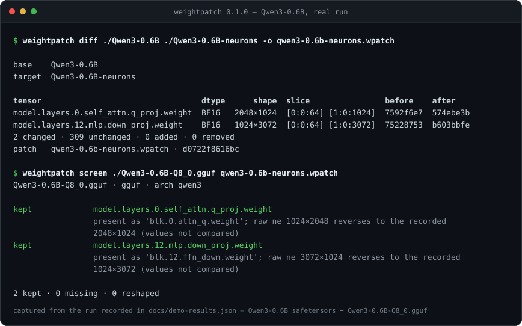

[English](./README.en.md) | **简体中文**

<div align="center">
  
</div>

<p align="center">
  
  
  
  
  
</p>

# weightpatch

**把一次权重改动，变成一份可以审阅、可以回滚、可以验证的补丁文件。**

现在的权重手术常常只留下两样东西：一个十几 GB 的新 checkpoint，和一句 README 说明。接收的人没法审阅改了什么，没法撤销，没法把自己的改动叠上去，也不知道这处改动经过一次量化之后还在不在。weightpatch 补的是这一层：对两个本地 safetensors 目录跑一次 `diff`，改动被写成稀疏的 `.wpatch`；`apply` / `revert` 按切片重放和撤销；`screen` 把同一份补丁对到单文件 GGUF 上，告诉你还剩几个张量。

免费、MIT、纯本地。没有服务端，没有账号，不发网络请求。

## 为什么需要它

一次神经元编辑或专家裁剪，最后都要经过交接才有人用。交接发生在这些地方：

- 发布者覆盖原文件，上传一份新 checkpoint。改动只存在于「新权重减去旧权重」里，而这个减法没人做过。
- 下载者拿到的是 10 GB 张量加一句 prose。想确认「去掉了哪一半专家」，只能相信发布者。
- 下游把它 requantize 成 GGUF。这一步最容易丢东西：命名从 `model.layers.12.mlp.down_proj.weight` 换成 `blk.12.ffn_down.weight`，二维权重按 GGML 的 `ne` 顺序转置，量化还会把权重打包成块。改过的切片可能还在，也可能已经被抹平，肉眼无法核对。
- agent 或自动化脚本直接改权重时，改动落成一次原地写入，连一个可以回滚的对象都没有。

这些场景不只在英文社区。DeepSeek-V4.1-Flash 的去专家件、Qwen3.5-0.8B 的神经元编辑、Kimi K3 的消融件，会以完整 checkpoint 的形式经 ModelScope、Gitee 二次分发，再被不同的人量化成不同精度的 GGUF。weightpatch 不替你做这次编辑；它负责这次编辑的交接。

## 它产出什么

`.wpatch` 是一个 zip，里面只有两样东西：

```
manifest.json
  id             sha256(base, parents, edit)，内容寻址
  base           { files: [{name, bytes, sha256}], tensor_count }
  parents        [id, ...]，记录叠加关系
  edit.tensors   [{ name, dtype, element_size, shape,
                    ranges: [[dim, start, end], ...],   # 只记改动切片的包围盒
                    before_sha256, after_sha256, ref }]
  edit.added     新增的张量名
  edit.removed   删除的张量名
  probe          { kind, claim, metrics }，作者声明的说法，不执行
values.npz
  只存改动切片的原始机器字：BF16 是 uint16，其它 dtype 是 uint8 字节；
  不存 numpy float，也不解码
```

三个决定值得说明：

- **只存切片。** 张量只有一部分变了，补丁就只带那一块。补丁可以被人读完，也可以叠加。
- **原始字，不是浮点。** BF16 在 numpy 里没有对应 dtype，`safetensors` 的 numpy 后端直接拒绝读取它。weightpatch 自己解析文件头（8 字节小端头长度 + JSON 偏移表），按字节区间读，所以 BF16 切片能逐位往返。
- **身份按张量，不按 checkpoint。** id 覆盖 `(base, parents, edit)`；应用时校验的是每个被改张量的 `before_sha256`。只要另一个 base 的这些张量还对得上，补丁就能应用过去。

## 安装

需要 Python 3.12。从源码安装：

```bash
git clone https://github.com/SuperMarioYL/weightpatch.git
cd weightpatch
uv venv --python 3.12
uv pip install --group dev -e .
source .venv/bin/activate

weightpatch --version
# weightpatch 0.1.0
```

`--group dev` 会一并装上测试用的 pytest。如果只想用命令，去掉它即可。

## 快速开始

下面用真实的 Qwen3-0.6B 走一遍。任意本地 BF16 checkpoint 都走同一条路径，换掉目录名即可。先拿到 base：`Qwen/Qwen3-0.6B` 的单文件 BF16 safetensors，约 1.5 GB。

```bash
mkdir -p Qwen3-0.6B
curl -fL -o Qwen3-0.6B/model.safetensors \
  https://huggingface.co/Qwen/Qwen3-0.6B/resolve/main/model.safetensors
```

再用仓库里的示例脚本造一份「被编辑过」的副本：复制目录，然后把两个张量的前 64 行按原始 BF16 机器字重写，每个 word 翻一位。没有随机数，也没有浮点解码，同一份 base 永远得到同一份改后摘要：

```bash
python examples/make_demo_edit.py ./Qwen3-0.6B ./Qwen3-0.6B-neurons
# Qwen3-0.6B-neurons: 311 tensors
#   model.layers.0.self_attn.q_proj.weight  BF16 2048×1024  rows 0:64  sha256 574ebe3b4fcb427b
#   model.layers.12.mlp.down_proj.weight  BF16 1024×3072  rows 0:64  sha256 b603bbfe2b46e3b9
```

然后记录、审阅、应用、回滚：

```bash
weightpatch diff ./Qwen3-0.6B ./Qwen3-0.6B-neurons -o qwen3-0.6b-neurons.wpatch
weightpatch show qwen3-0.6b-neurons.wpatch

weightpatch apply  ./Qwen3-0.6B qwen3-0.6b-neurons.wpatch -o ./rebuilt
weightpatch revert ./rebuilt   qwen3-0.6b-neurons.wpatch -o ./back

cmp ./Qwen3-0.6B/model.safetensors ./back/model.safetensors && echo "revert is byte-identical"
```

`diff` 的输出是改动列表，不是两份模型的全文：

```
tensor                                  dtype      shape  slice                before    after
model.layers.0.self_attn.q_proj.weight  BF16   2048×1024  [0:0:64] [1:0:1024]  7592f6e7  574ebe3b
model.layers.12.mlp.down_proj.weight    BF16   1024×3072  [0:0:64] [1:0:3072]  75228753  b603bbfe
2 changed · 309 unchanged · 0 added · 0 removed
patch   qwen3-0.6b-neurons.wpatch · d0722f8616bc
```

`309 unchanged` 是 Qwen3-0.6B 里另外那 309 个没动过的张量。`apply` 之后再 `revert`，`back/model.safetensors` 与 base 逐字节相同，`cmp` 不输出任何内容。补丁 id 是 `d0722f8616bcfc05a80870389ddbf6b279895c4f2eabe12f8fcd0124ea6741dd`；同样的输入重跑，得到同一个 id。

`apply` 和 `revert` 的输出目录只写张量分片（以及存在的 `model.safetensors.index.json`）；`config.json`、tokenizer 这类非权重文件不会被复制，权重是补丁的契约。

想做一次跨 base 的应用，就把 `./Qwen3-0.6B` 换成另一个仍持有相同 pre-image 的目录；想叠第二个改动，就在应用后的目录上再 `diff` 一次，然后 `stack`。

## 演示



上图是真实运行的终端录制：base 是 `Qwen/Qwen3-0.6B` 的 BF16 safetensors（311 个张量、1,503,300,328 字节），下游产物是 `Qwen/Qwen3-0.6B-GGUF` 里的单文件 `Qwen3-0.6B-Q8_0.gguf`（Q8_0、639,446,688 字节）。没有合成夹具，也没有本地伪造的 GGUF。

1. `diff` 找到两处 BF16 切片改动（`2 changed · 309 unchanged`），写出补丁 `d0722f8616bc`。
2. `screen` 读 `general.architecture=qwen3`，用 GGML 名称表把 `model.layers.0.self_attn.q_proj.weight` 映射到 `blk.0.attn_q.weight`、把 `model.layers.12.mlp.down_proj.weight` 映射到 `blk.12.ffn_down.weight`；再把 GGUF 的 `ne` 顺序反转回来：`1024×2048 → 2048×1024`、`3072×1024 → 1024×3072`。
3. 结论是 `2 kept · 0 missing · 0 reshaped`，退出码 0。

命令、完整输出、输入文件的 sha256、依赖版本和这次运行的边界都记在 [`docs/demo-results.json`](./docs/demo-results.json)；照着本文的命令重跑，得到的是同一份输出。

拿自己的补丁对自己的单文件 GGUF 跑。同一次量化导出来自 `Qwen/Qwen3-0.6B-GGUF`，单文件、约 639 MB：

```bash
curl -fL -o Qwen3-0.6B-Q8_0.gguf \
  https://huggingface.co/Qwen/Qwen3-0.6B-GGUF/resolve/main/Qwen3-0.6B-Q8_0.gguf
weightpatch screen ./Qwen3-0.6B-Q8_0.gguf qwen3-0.6b-neurons.wpatch
```

只要有改动没存活，命令就返回非零，可以直接放进发布流程里当闸门。

## 命令

| 命令 | 作用 | 退出码 |
| --- | --- | --- |
| `diff BASE TARGET [-o PATCH] [--json]` | 逐张量比较两个 safetensors 目录，只报改动的切片 | 0 成功 |
| `show PATCH [--json]` | 打印补丁里的切片范围、dtype、两侧摘要、probe | 0 成功 |
| `apply TARGET PATCH -o OUT` | 写出 TARGET 的副本并应用补丁 | 0 成功 |
| `revert TARGET PATCH -o OUT` | 写出副本并撤销补丁，逐字节回到记录前 | 0 成功 |
| `stack TARGET PATCH... -o OUT` | 按顺序应用两个及以上补丁，逐张量校验 pre-image 链 | 0 成功；少于两个补丁为 2 |
| `screen SOURCE PATCH [--json]` | 在 safetensors 导出或单文件 GGUF 上检查改动是否还在 | 0 全部 kept；1 有 missing/reshaped；1 没有可筛的切片 |

错误信息写到 stderr，返回 1；参数用错返回 2。`diff`、`show`、`screen` 支持 `--json`，输出稳定的文档，便于接进 CI。

几个约束在写入前就会检查：

- **pre-image 不符就什么都不写。** `apply` 在复制文件之前逐个校验被改张量的当前摘要，遇到不匹配直接退出，输出目录保持未创建。
- **同一调用里叠加的补丁，切片不许重叠。** 两个补丁改同一张量的同一段切片会被拒绝，并在错误里给出重叠范围。
- **`stack` 只按给定顺序应用。** 每个补丁的 pre-image 必须与它之前所有写入的结果一致；同一张量上出现多个补丁时就是链式摘要校验，任何一步对不上都不写盘。

## screen 怎么判断

**GGUF** 只比存在性和形状，不解量化。顺序是固定的，少一步都会让改动看起来「丢了」：

1. 读 `general.architecture`。这个版本的 `gguf` 不认识的架构（例如未来的 `qwen4`）整份报 `unsupported-arch`，不做名称匹配。
2. 用 `arch` 和 `block_count` 建 GGML 名称表，把每个 safetensors 名映射过去。映射不到就是 `missing`，不做字符串相似度猜测。如果一个都映射不到（例如 `qwen35` 的 `linear_attn.*` 命名空间），整份报一条 `unmapped-arch`：这是名称表的缺口，不是逐张量丢失。
3. 反转 `GGUFReader.shape`。那个字段是 GGML 的 `ne` 顺序，二维矩阵到达时是转置的；直接比较会让每个矩阵都失败。

**量化过的 safetensors 导出**只比存储的字节。名字、dtype、shape 和字节摘要都与补丁记录的 after 侧一致，才是 `kept`。打包后的导出（`U32` 权重 + `.scales` / `.biases`）形状和摘要都对不上，报 `reshaped`，并把同级的伴生张量名一起列出。这一类只说明权重被重新打包，不说明值是否幸存。

v0.1 的边界：

- GGUF 只读；不支持写入或重新量化，也不解量化后比较数值。
- 只打开一个 `.gguf` 文件；多分片集合（例如 10 份的 DeepSeek-V4.1-Flash）打不开。
- `gguf` 未声明的架构、名称表解析不出的命名空间，分别报 `unsupported-arch` / `unmapped-arch`，不会猜。
- 只携带切片。补丁可以记录 `added` / `removed` 张量名，但没有它们的值，所以这类补丁可以 `show`、可以 `screen`，不能 `apply`。
- 只支持 safetensors；PyTorch `.bin` / pickle checkpoint 不支持。
- 不做三方合并，也没有交互式冲突解决；没有配置文件，没有环境变量，没有服务端。

## 与整份 checkpoint、脚本的区别

| | 整份 checkpoint | 改权重的脚本 | `.wpatch` |
| --- | --- | --- | --- |
| 交接体积 | 十几 GB | 几 KB 代码 | 只含改动切片 |
| 接收方能审阅 | 不能 | 要读代码，还要有同样的环境 | `show` 出切片范围和两侧摘要 |
| 能回滚 | 依赖发布者保留原文件 | 依赖脚本还能跑、随机数还对得上 | `revert` 逐字节还原 |
| 能验证 pre-image | 不能 | 不能 | `apply` 前逐张量校验 |
| 能查 requantize 后是否还在 | 不能 | 不能 | `screen` |

heretic 这类工具解决的是「做这次编辑」；weightpatch 解决的是「这次编辑如何交接」。两者可以并用：用任意方式改出 derivative 目录，再 `diff` 出补丁。

## Roadmap

v0.1.0 已经能用的是本文描述的全部内容：`diff`、`show`、`apply`、`revert`、`stack`、`screen`（safetensors 和单文件 GGUF），以及上面这套测试。

还没做、也没有承诺时间的部分：

- 多分片 GGUF 读取，让 10 分片的 DeepSeek-V4.1-Flash 类权重也能筛。
- GGUF 解量化后逐切片比较数值，把「还在不在」推进到「值对不对」。
- 为 `added` / `removed` 张量携带字节，让这类补丁也能应用。
- 三方合并与交互式冲突解决。

下一批想在真实 derivative 上验证的目标是 DeepSeek-V4.1-Flash 的去专家件、Qwen3.5-0.8B 的编辑件和 Kimi K3 的消融件。测试跑在临时目录里的离线夹具上，不需要联网；本文的演示与所有数字来自真实的 Qwen3-0.6B 和真实的 Q8_0 GGUF，记录在 `docs/demo-results.json`。

## License

MIT。见 [LICENSE](./LICENSE)。

<p align="center"><sub><a href="./LICENSE">MIT</a> © 2026 SuperMarioYL</sub></p>
